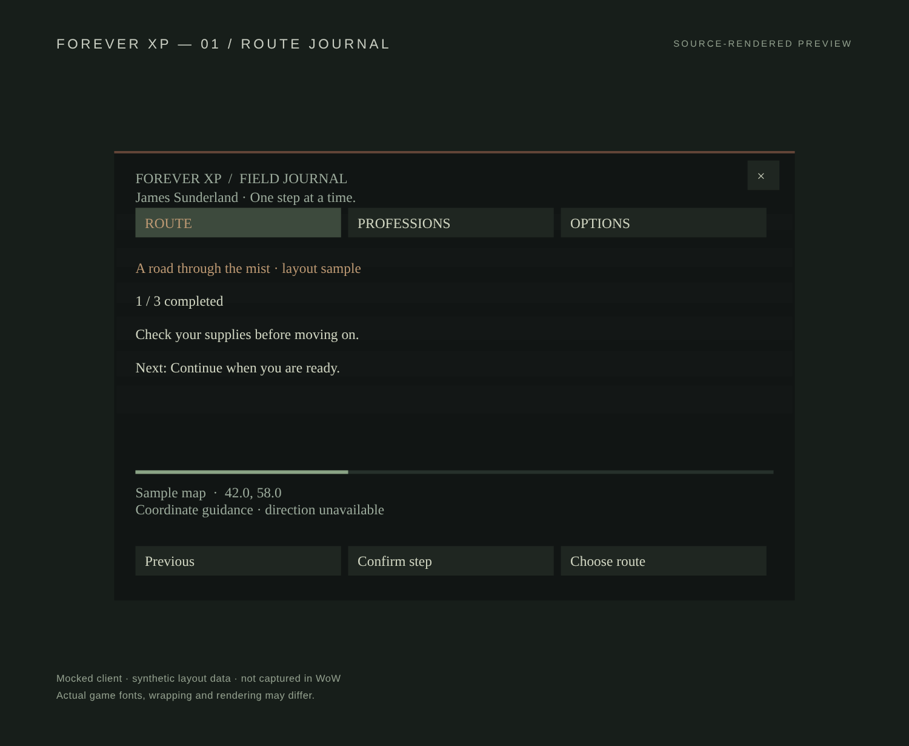
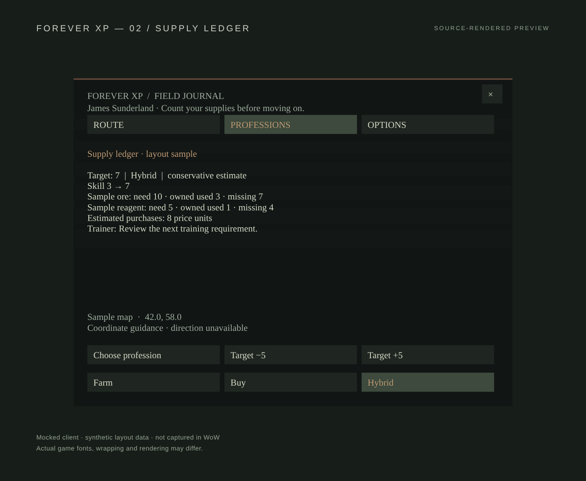

# Interface previews

These are source-rendered previews using mocked client frames and synthetic
layout data. They are not in-game screenshots. Font metrics and texture loading
still need live-client verification.

## Route journal

## Supply ledger

## Options

## Elwynn reference route

This view uses the authored reference guide, with live route validation pending.

## Level-aware Alliance 1–60

The mocked character is level 14; older quests remain saved while the campaign
selects a suitable quest from its reference pool. Live validation is pending.

## Warcraft journal

Original parchment and brass styling, rendered with a mocked level-35 character.

## Warhammer 40K field log

Original gunmetal, crimson and bone styling, rendered at level 58.

## Theme selection

Options provides immediate, persistent theme choices. These are source-rendered
layouts, not screenshots from the live game.

Version 0.5.1 removes the portrait sidebar. These previews use the wider
text and control layout; James’s original header notes remain.

## Crafting guide with tracking

A synthetic skill-160 Alchemy observation drives the actual reference guide UI.

## Gathering guide with tracking

A synthetic Mining observation shows the matching resource stage and carried ore.

These remain source-rendered layouts, not in-game screenshots.
